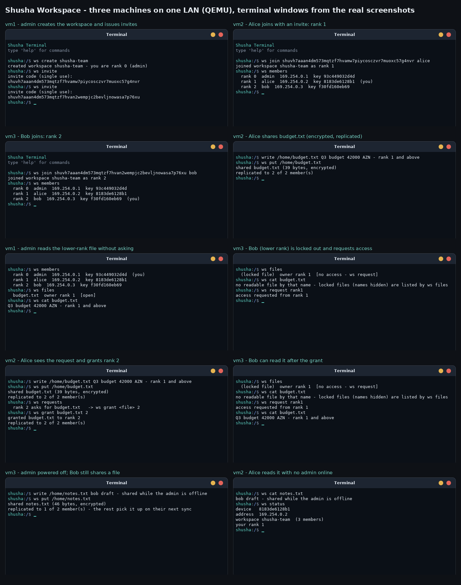

# Workspace proof of concept (LAN)

Three unmodified Shusha desktops boot in QEMU on one virtual Ethernet
segment. Every screenshot below is a real `screendump` of a running
machine, taken by `scripts/ws-gui-demo.py`. Nothing is mocked.

| Machine | Address | Who | Rank |
|---|---|---|---|
| vm1 | 169.254.0.1 | admin (creator) | 0 |
| vm2 | 169.254.0.2 | alice (joined first) | 1 |
| vm3 | 169.254.0.3 | bob (joined second) | 2 |



## The steps

1. [vm1 creates `shusha-team`](01-vm1-admin-creates-and-invites.png) and
   issues two single-use invite codes.
2. [vm2 joins as alice](02-vm2-alice-joins-rank1.png) and gets rank 1.
3. [vm3 joins as bob](03-vm3-bob-joins-rank2.png) and gets rank 2. All
   three machines verify the same admin-signed membership log.
4. [Alice shares `budget.txt`](04-vm2-alice-shares-budget.png). It is
   encrypted on her machine, signed, and replicated to both others.
5. [The admin reads it without asking](05-vm1-admin-reads-lower-rank-file.png),
   because a higher rank can always open a lower rank's files.
6. [Bob cannot](06-vm3-bob-locked-out-and-requests.png). He holds the
   ciphertext, but even the file name is hidden from him. He sends a
   request.
7. [Alice sees the request and grants rank 2](07-vm2-alice-grants-bob.png).
8. [Bob can now read it](08-vm3-bob-reads-after-grant.png).
9. [vm1 is powered off. Bob shares a file anyway](09-vm3-admin-offline-bob-shares.png).
   It reaches the 1 member who is online.
10. [Alice reads it with no admin online](10-vm2-admin-offline-alice-reads.png).

## What is on the wire

vm3 recorded every packet on the segment during the demo
([full output](wire-check.txt)):

```
secure-channel packets on UDP 7100: 87, between 6 address pairs
  HS1  initiator: X25519 + ML-KEM-768 public keys                    x4
  HS2  responder: X25519 + ML-KEM ciphertext + encrypted identity    x4
  HS3  initiator: encrypted identity + signature                     x4
  DATA ChaCha20-Poly1305 frame                                       x75

encrypted payload: 29488 bytes, entropy 7.991 bits/byte (8.0 = indistinguishable from random)
plaintext '42000 AZN'      not present anywhere in the capture
plaintext 'budget.txt'     not present anywhere in the capture
plaintext 'Q3 budget'      not present anywhere in the capture
plaintext 'alice'          not present anywhere in the capture
plaintext 'bob draft'      not present anywhere in the capture
plaintext 'shusha-team'    not present anywhere in the capture
```

- File contents, file names, member names and the workspace name never
  appear on the network.
- Each pair of machines runs a hybrid post-quantum handshake (X25519 +
  ML-KEM-768). After that, everything is AEAD frames.
- On top of the channel encryption, the file itself is encrypted
  end-to-end under its own key. A member that relays a file it may not
  read only ever holds ciphertext.

## Automated checks

`scripts/ws-lan-test.py` runs the same ideas on **five** machines, with
32 assertions:

- ranks 0–4 in join order;
- forged and reused invites refused;
- all five machines agree on the log;
- a rank-2 file is readable by ranks 0–2 and locked for ranks 3–4;
- request and grant;
- reading and sharing with the admin powered off.

The [latest run](ws-lan-test.txt) passed all 32.

## Reproduce

```bash
make SERIAL_MIRROR=1 shusha.iso lan.iso
python3 scripts/ws-gui-demo.py              # screenshots -> build/wsshots
python3 scripts/wire-check.py build/lan/vm3.pcap "42000 AZN" "budget.txt"
python3 scripts/ws-lan-test.py              # 5 machines, 32 checks
```

## Limits of this proof

- **LAN only.** The internet path (DHT, STUN, relays) is not built yet.
- **Not built yet:**
  - removing members and rekeying;
  - stewards;
  - separate edit rights;
  - live co-editing.
- **State lives in RAM** on the live image.
- **No outside review yet.** This shows the design working end to end. It
  is not a substitute for an external review of the cryptography and
  code.
